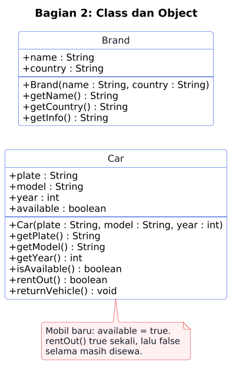
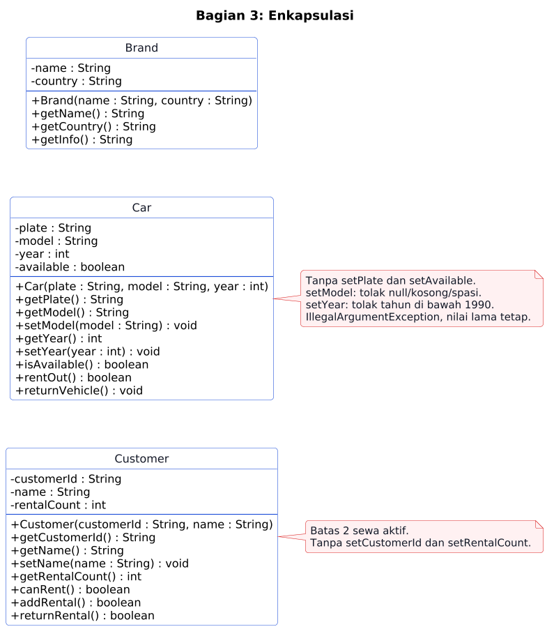
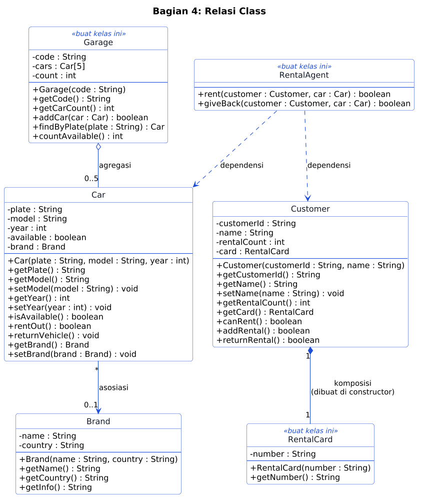
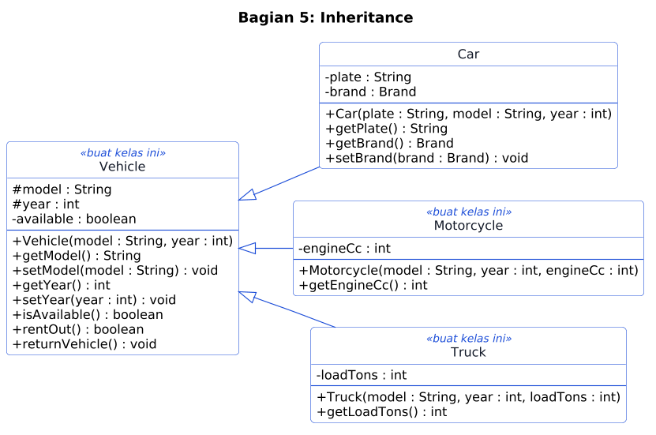
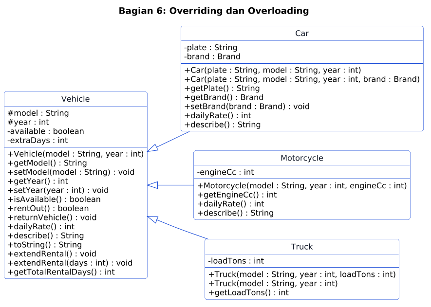
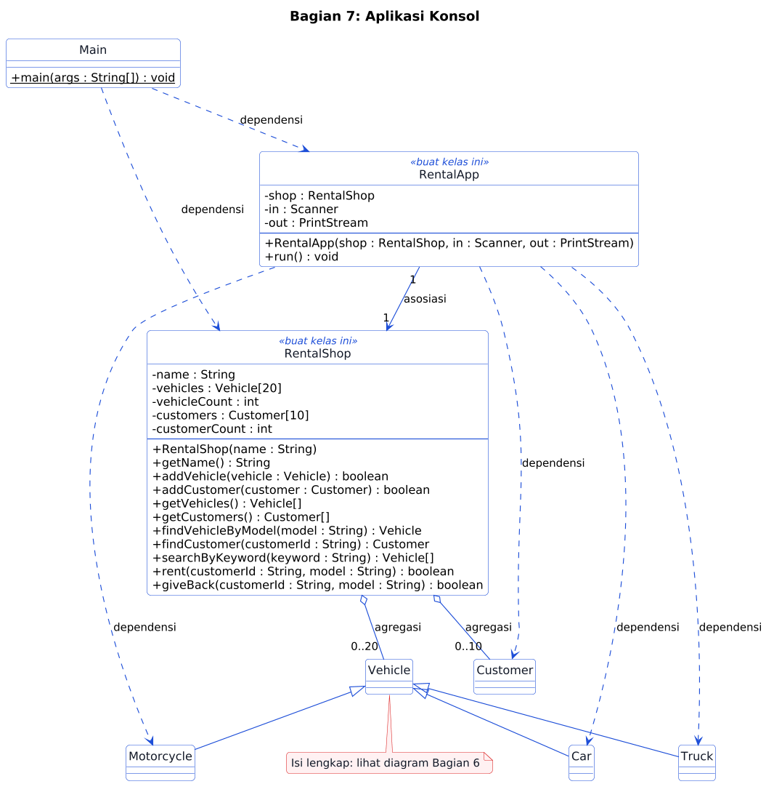

# UTS PBO Varian A: Rental Kendaraan

Aplikasi konsol rental kendaraan Polinema. Satu proyek, tujuh bagian (Pertemuan 1 sampai 7), satu video penjelasan, dan satu laporan singkat.

## Aturan

- Jangan ubah `src/test/**`, `.github/**`, dan `.wakatime-project`.
- Ikuti diagram persis: nama kelas, field, constructor, dan method.
- Semua field `private`, kecuali `model` dan `year` di `Vehicle` (`protected`).
- Pakai array biasa. Jangan pakai `List` atau `ArrayList`.
- Jangan pakai `System.out.println` di `RentalShop` dan kelas model. Tampilan hanya di `Main` dan `RentalApp`.
- Nyalakan WakaTime setiap kali mengerjakan (Langkah 0).
- Kerjakan sendiri tanpa bantuan AI. Jangan memakai AI (chatbot, asisten kode, atau autocomplete berbasis AI) untuk menulis kode, menjawab soal, atau menyusun laporan. Kode, video, dan laporan harus hasil kerjamu, dan kamu menjelaskan kodemu langsung di video. Kode atau laporan salinan tidak dinilai.

## Langkah 0: Pasang WakaTime (wajib, sebelum menulis kode)

1. Buat akun gratis di [wakatime.com](https://wakatime.com), salin API key dari [wakatime.com/settings/api-key](https://wakatime.com/settings/api-key). Jangan bagikan key ini.
2. Pasang plugin di editormu: NetBeans (`Tools > Plugins`, cari "WakaTime"), VS Code (ekstensi `WakaTime.vscode-wakatime`), atau IntelliJ IDEA (`Settings > Plugins`).
3. Tempel API key saat diminta. Ketik kode beberapa menit, lalu buka [wakatime.com/dashboard](https://wakatime.com/dashboard) dan pastikan project **uts-a-rental** muncul.

`.wakatime-project` berisi `uts-a-rental`. Jangan diubah. Waktu pengerjaan tanpa plugin tidak dihitung.

## Daftar Isi

1. [Aturan](#aturan)
2. [Langkah 0: WakaTime](#langkah-0-pasang-wakatime-wajib-sebelum-menulis-kode)
3. [Studi Kasus](#studi-kasus)
4. [Memulai](#memulai)
5. [Cara Membaca Diagram](#cara-membaca-diagram)
6. [Bagian 1 sampai 7](#bagian-1-pertemuan-1-pengantar)
7. [Video Penjelasan](#video-penjelasan-wajib)
8. [Laporan Singkat](#laporan-singkat-pdf-2-3-halaman)
9. [Pengumpulan](#pengumpulan)
10. [Penilaian](#penilaian)

## Studi Kasus

Rental Polinema menyewakan tiga jenis kendaraan:

- **Mobil**: tarif Rp350.000 per hari, punya plat nomor dan merek.
- **Motor**: tarif Rp100.000 per hari, punya kapasitas mesin (cc).
- **Truk**: memakai tarif dasar Rp250.000 per hari, punya muatan (ton).

Setiap **pelanggan** punya kartu rental (`RC-` diikuti ID pelanggan) dan boleh menyewa paling banyak **2** kendaraan sekaligus. Lama sewa dasar adalah 1 hari. Perpanjangan standar menambah 2 hari. Tahun produksi kendaraan minimal **1990**. Petugas memakai aplikasi konsol untuk menambah kendaraan, mendaftarkan pelanggan, menyewakan, menerima pengembalian, dan mencari kendaraan.

## Memulai

1. Buka https://github.com/dhanifudin/oop-rental, klik **Use this template**, lalu **Create a new repository**. Pilih **Private**, lalu undang akun GitHub Dosen (`dhanifudin`) sebagai collaborator (**Settings > Collaborators**).
2. Clone repositori barumu. Commit dan push setiap selesai satu bagian.
3. Buka tab **Actions**. Autograder berjalan di setiap push dan menampilkan nilai kodemu.

```
mvn -q test                          # semua tes
mvn -q test -Dtest=P02CarTest        # satu kelas tes
mvn -q compile exec:java             # jalankan Main (butuh JDK 17+ dan Maven)
```

NetBeans: `File > Open Project`, pilih folder repositori. VS Code: pasang "Extension Pack for Java". Baca pesan tes yang gagal: pesannya menjelaskan apa yang kurang.

Pada starter hanya ada `Main`, `Brand`, `Car`, dan `Customer` (kerangka dengan `TODO`). Kelas lain kamu buat sendiri sesuai diagram. Kelas dengan label `<<buat kelas ini>>` di diagram belum ada di starter.

## Cara Membaca Diagram

| Simbol | Arti |
|---|---|
| `+` / `-` / `#` | `public` / `private` / `protected` |
| `nama : Tipe` | field atau parameter bernama `nama` bertipe `Tipe` |
| `<<buat kelas ini>>` | kelas belum ada di starter |
| `-->` | asosiasi |
| `o--` | agregasi (belah ketupat kosong) |
| `*--` | komposisi (belah ketupat penuh) |
| `..>` | dependensi |
| `<\|--` | inheritance (`extends`) |
| `0..5`, `1`, `*` | multiplicity (jumlah objek) |

Diagram kelas adalah spesifikasi utama. Baca per kotak kelas (field di atas, constructor dan method di bawah), lalu baca garis antar kelas. Diagram keseluruhan: `docs/class-diagram.png`.

Setiap bagian punya satu kotak **Bantuan**. Coba dulu sendiri sebelum membukanya.

---

## Bagian 1 (Pertemuan 1): Pengantar

### Yang Diuji Oleh Autograder

- Baris **pertama** output `Main` adalah persis `Welcome to Polinema Rental`. Setelah itu kamu bebas menambah baris lain.

### Pikirkan Dulu

- Apa yang terjadi saat kamu menekan Run: apa yang dikerjakan compiler, apa yang dikerjakan JVM?
- Method mana yang pertama kali dijalankan Java, dan mengapa harus `static`?

<details>
<summary>Bantuan</summary>

- Cek `java -version`. Kamu butuh versi 17 atau lebih.
- Perintah menampilkan teks berbentuk `System.out.println("teks kamu");`, ditulis di dalam kurung kurawal `main`.
- Huruf besar-kecil, spasi, dan tanda baca harus persis sama dengan teks di soal. Jangan lupa titik koma.
- Error yang sering muncul: `System` ditulis huruf kecil, tanda kutip tidak berpasangan, kode di luar `main`.

</details>

### Periksa Hasil

Tes yang harus lulus: `P01MainOutputTest`.

---

## Bagian 2 (Pertemuan 2): Class dan Object



### Yang Diuji Oleh Autograder

- Constructor menyimpan semua parameternya, dan getter mengembalikan nilai yang sama.
- `Brand.getInfo()` mengembalikan `nama (negara)`. Contoh: `Wuling (China)`.
- Mobil yang baru dibuat **tersedia**.
- `rentOut()` berhasil (`true`) satu kali. Selama mobil masih disewa, memanggilnya lagi menghasilkan `false`.
- `returnVehicle()` membuat mobil bisa disewa lagi.
- Dua objek `Car` tidak saling memengaruhi.
- Di bagian ini field boleh `public` (seperti di diagram). Di Bagian 3 kamu menutupnya.

### Pikirkan Dulu

- Data apa yang perlu diingat setiap `Car`? Mana yang berasal dari parameter, mana yang diatur sendiri oleh objek?
- Agar objek tahu sedang disewa atau tidak, apa yang harus diingatnya? Berapa nilai awalnya?
- Di constructor, nama parameter sama dengan nama field. Bagaimana Java membedakannya?

<details>
<summary>Bantuan</summary>

- Deklarasikan field di dalam kelas, di luar method. Tipe field dibaca dari diagram.
- `this` menunjuk ke objek yang sedang dikerjakan: `this.nama = nama;`.
- Status sewa cocok disimpan sebagai `boolean`. Method `boolean` boleh punya dua `return`: periksa kondisi dulu, baru ubah status.
- `getInfo` menyusun teks dari dua data memakai operator `+`.
- Cara memeriksa tanpa tes: di `Main`, buat dua `Car`, panggil `rentOut()` dua kali pada yang pertama, lalu cetak `isAvailable()` keduanya.

</details>

### Periksa Hasil

Tes yang harus lulus: `P02BrandTest` dan `P02CarTest`.

---

## Bagian 3 (Pertemuan 3): Enkapsulasi



### Yang Diuji Oleh Autograder

Semua kelas: semua field `private`.

`Car`:

- Model `null`, kosong, atau hanya spasi **ditolak**. Tahun di bawah **1990** (termasuk 0 dan negatif) **ditolak**.
- Penolakan berarti `IllegalArgumentException` dilempar dan nilai lama **tetap**.
- Constructor juga menolak data tidak valid (`plate` tidak boleh kosong).
- `plate` read-only (tanpa setter). Status tersedia tidak punya setter, hanya berubah lewat `rentOut()` dan `returnVehicle()`.

`Customer` (isi dari kerangka sesuai diagram):

- `customerId` dan `rentalCount` read-only. `customerId` dan nama tidak boleh kosong.
- `setName` menolak nama kosong dan menjaga nama lama.
- Jumlah sewa selalu antara 0 dan **2**. `addRental()` dan `returnRental()` mengembalikan `true` jika berhasil dan `false` jika sudah di batas.
- `canRent()` menjawab apakah pelanggan masih boleh menyewa.

### Pikirkan Dulu

- Jika `Customer` punya `public int rentalCount`, baris kode apa yang merusak aturan "maksimal 2"? Bagaimana `private` mencegahnya?
- Constructor dan setter punya aturan validasi yang sama. Bagaimana menghindari menulisnya dua kali?
- Apakah `canRent()` perlu field sendiri? Apa risikonya jika datanya tidak sinkron dengan `rentalCount`?
- Mengapa `customerId` tidak boleh punya setter?

<details>
<summary>Bantuan</summary>

- Urutan aman di setter: **periksa dulu**, baru isi field. Jika tidak valid, hentikan dengan `throw new IllegalArgumentException(...)` sebelum field disentuh.
- Cek `null` **lebih dulu**, sebelum memanggil method pada teks. `String` punya method untuk memeriksa teks kosong atau hanya spasi.
- Constructor boleh memanggil setter milik kelasnya sendiri, sehingga aturan validasi hanya ada di satu tempat.
- `canRent()` dihitung dari `rentalCount` setiap kali dipanggil, tanpa field baru. `addRental()` cukup bertanya ke `canRent()` agar angka batas hanya ada di satu tempat.
- `returnRental()` tidak boleh membuat jumlah sewa negatif.
- Setelah field jadi `private`, bagian `Main` atau kode lain yang mengakses field langsung akan error. Ganti dengan getter.

</details>

### Periksa Hasil

Tes yang harus lulus: `P03EncapsulationTest` dan `P03CustomerTest`. Tes Bagian 2 tidak boleh rusak.

---

## Bagian 4 (Pertemuan 4): Relasi Class



### Yang Diuji Oleh Autograder

`Car` dan `Brand` (asosiasi):

- Mobil baru belum punya merek. `getBrand()` mengembalikan objek `Brand` **yang sama** dengan yang diberikan ke `setBrand`. Dua mobil boleh berbagi satu `Brand`. `setBrand(null)` melepas merek.

`Customer` dan `RentalCard` (komposisi):

- Setiap `Customer` punya kartu bernomor `RC-` diikuti `customerId`. Contoh: `RC-C001`.
- Kartu **tidak** diberikan dari luar: `Customer` tidak punya constructor yang menerima `RentalCard`. Dua pelanggan punya dua kartu berbeda. `getCard()` selalu mengembalikan kartu yang sama.

`Garage` (agregasi):

- Kapasitas **5** mobil. `addCar` mengembalikan `false` jika garasi penuh atau mobilnya `null`.
- `findByPlate` mengembalikan objek `Car` yang sama (bukan salinan), atau `null`.
- `countAvailable` menghitung mobil yang saat ini tersedia.

`RentalAgent` (dependensi):

- Tidak punya field sama sekali.
- `rent(customer, car)` berhasil hanya jika pelanggan boleh menyewa **dan** mobil tersedia. Jika berhasil, mobil disewa dan jumlah sewa pelanggan bertambah. Jika gagal, tidak ada yang berubah.
- `giveBack(customer, car)` berhasil hanya jika mobil sedang disewa dan pelanggan punya sewa aktif. Jika berhasil, mobil tersedia lagi dan jumlah sewa berkurang.

### Pikirkan Dulu

Jawab untuk **setiap** garis relasi di diagram:

- Siapa yang **membuat** objek di ujung garis: kelas ini sendiri, atau kode di luarnya?
- Jika pemilik dibuang, apakah objek di ujung garis ikut hilang?
- Objek di ujung garis perlu disimpan sebagai **field**, atau cukup muncul sebagai **parameter** method?
- Apa arti `0..5` dan `0..1`?

<details>
<summary>Bantuan</summary>

- Asosiasi: `setBrand` hanya **menyimpan referensi** yang diterima. Jangan membuat `Brand` baru.
- Komposisi: field kartu diisi **di dalam constructor** `Customer` (setelah validasi lolos) dengan `new RentalCard(...)`, bukan dari parameter. Nomor kartu dibentuk dari `RC-` digabung `customerId`.
- Agregasi: array berukuran tetap butuh satu variabel penghitung isi. Telusuri hanya slot yang terisi. Bandingkan teks dengan `equals`, bukan `==`.
- Dependensi: `RentalAgent` tidak punya field. Method milik `Customer` dan `Car` sudah menjawab sebagian besar pertanyaan, panggil, jangan tulis ulang aturannya.
- Urutan pemeriksaan di `rent` penting: pastikan pelanggan boleh menyewa **sebelum** mengubah status mobil. Pada `giveBack`, pastikan pengembalian sah sebelum mengubah apa pun.

</details>

### Periksa Hasil

Tes yang harus lulus: `P04AssociationTest`, `P04GarageAggregationTest`, `P04CustomerCardCompositionTest`, dan `P04RentalAgentDependencyTest`.

---

## Bagian 5 (Pertemuan 6): Inheritance



### Yang Diuji Oleh Autograder

- `Car`, `Motorcycle`, dan `Truck` adalah subclass langsung dari `Vehicle`.
- `Vehicle` memvalidasi `model` dan `year` seperti `Car` di Bagian 3. Field `model` dan `year` bersifat `protected`, tidak ada field `public`.
- `Car` tidak lagi menyimpan `model`, `year`, dan status tersedia sendiri, dan tidak menulis ulang method yang sudah ada di `Vehicle`.
- `Motorcycle` (`engineCc`) dan `Truck` (`loadTons`) menyimpan data khususnya (`private`) dan memakai getter serta `rentOut`/`returnVehicle` dari `Vehicle`.
- Validasi setter ikut berlaku di semua subclass. Semua tes Bagian 2 sampai 4 masih lulus.

### Pikirkan Dulu

- Apa yang **sama** di `Car` dan `Motorcycle`? Apa yang **khusus**?
- "`Motorcycle` adalah sebuah `Vehicle`" masuk akal. Apakah "`RentalShop` adalah sebuah `Car`" juga masuk akal?
- Mengapa `model` dan `year` ditandai `#` dan bukan `-`?
- Jika `Vehicle` meminta `model` dan `year` di constructor, siapa yang mengisinya saat `Motorcycle` dibuat?

<details>
<summary>Bantuan</summary>

- `extends` menyatakan hubungan IS-A. Constructor tidak diwariskan: subclass memanggil `super(...)` sebagai **baris pertama**.
- Kerjakan bertahap dan jalankan seluruh tes setiap langkah: (1) buat `Vehicle`, salin field dan method umum dari `Car` ke sana; (2) `Car extends Vehicle` dan panggil `super` di constructor; (3) hapus duplikat dari `Car`; (4) buat `Motorcycle` dan `Truck` dengan pola yang sama.
- `Vehicle(model, year)` mengisi `model` dan `year` lewat setter-nya dan membuat status tersedia.
- Error "constructor Vehicle ... cannot be applied to given types" berarti sebuah subclass belum memanggil `super(...)` dengan argumen yang sesuai.

</details>

### Periksa Hasil

Tes yang harus lulus: `P06InheritanceTest`. Tes Bagian 2 sampai 4 tidak boleh rusak.

---

## Bagian 6 (Pertemuan 7): Overriding dan Overloading



### Yang Diuji Oleh Autograder

Method baru di `Vehicle`:

- `dailyRate()` mengembalikan **250000** (tarif dasar).
- `describe()` mengembalikan deskripsi singkat, dan `toString()` mengembalikan hasil yang sama dengan `describe()`.
- `extendRental()` menambah perpanjangan **2** hari. `extendRental(int days)` menambah sebanyak `days`, dan menolak 0 atau negatif dengan `IllegalArgumentException`.
- `getTotalRentalDays()` adalah lama sewa dasar (**1** hari) ditambah semua perpanjangan.

Nilai yang diharapkan:

| Objek | `dailyRate()` | `describe()` |
|---|---|---|
| `Vehicle("Generic", 2000)` | 250000 | `Generic (2000)` |
| `Car` tanpa merek | 350000 | `Avanza (2021) - Unknown` |
| `Car` dengan merek Toyota | 350000 | `Avanza (2021) - Toyota` |
| `Motorcycle("Vario", 2022, 125)` | 100000 | `Vario (2022) [125 cc]` |
| `Truck("Canter", 2020, 4)` | 250000 | `Canter (2020)` |

Contoh total hari: kendaraan baru = 1. Setelah `extendRental()` = 3. Setelah `extendRental(3)` dan `extendRental(2)` = 6.

Constructor baru:

- `Car(plate, model, year, brand)` langsung mengisi merek.
- `Truck(model, year)` memberi `loadTons` **5**. Versi 3 parameter tetap berfungsi.

Struktur: `Car` dan `Motorcycle` meng-override `dailyRate()`. `Truck` **tidak** meng-override-nya.

### Pikirkan Dulu

- `describe()` milik `Car` dan milik `Vehicle`: bagian mana yang sudah dikerjakan parent? Perlukah kamu menulisnya ulang?
- `Truck` tidak punya `dailyRate()` sendiri. Mengapa? Versi siapa yang berjalan?
- `extendRental()` dan `extendRental(int)` sama-sama bernama `extendRental`. Apa yang membedakannya bagi compiler? Bisakah salah satu memakai yang lain?
- Dua constructor `Car` hampir sama. Bagaimana menghindari menyalin isinya?

<details>
<summary>Bantuan</summary>

- Pasang `@Override` pada setiap override: compiler menolak jika nama atau parameter salah.
- `super.describe()` memanggil versi parent. Teks `Unknown` hanya dipakai jika `brand` bernilai `null`.
- `toString()` cukup memanggil `describe()`.
- `extendRental()` cukup memanggil `extendRental(int)` dengan angka default. Perpanjangan diingat di field `private` di `Vehicle`.
- `getTotalRentalDays()` menjumlahkan 1 dan total perpanjangan.
- Constructor boleh memanggil constructor lain di kelas yang **sama** dengan `this(...)`, juga harus di baris pertama.
- Sengaja `Truck` tidak override apa pun: ia mewarisi `dailyRate()` dan `describe()` dari `Vehicle`.

</details>

### Periksa Hasil

Tes yang harus lulus: `P07OverrideTest` dan `P07OverloadTest`.

---

## Bagian 7 (Gabungan P1 sampai P7): Aplikasi Konsol



### Pikirkan Dulu

- `RentalShop` tidak boleh mencetak apa pun. Apa yang kamu ganti jika tampilannya suatu hari menjadi GUI, dan apa yang tidak perlu disentuh?
- Array `vehicles` berisi `Car`, `Motorcycle`, dan `Truck` sekaligus. Mengapa itu diizinkan? Apa nama konsepnya?
- Mengapa `RentalApp` menerima `Scanner` dan `PrintStream` lewat constructor, bukan memakai `System.in` dan `System.out` langsung?
- Pada alur "sewa": objek mana yang dipanggil, dan method apa yang berjalan di masing-masingnya?

### Yang Diuji Oleh Autograder: kelas `RentalShop`

Tidak boleh ada `System.out` di dalamnya.

| Method | Aturan |
|---|---|
| `addVehicle` | `false` jika `null` atau array penuh (20 kendaraan). |
| `addCustomer` | `false` jika `null`, penuh (10 pelanggan), atau `customerId` sudah terdaftar. |
| `getVehicles`, `getCustomers` | Array baru yang **hanya berisi elemen terisi**. |
| `findVehicleByModel` | Model dicocokkan **tanpa peduli huruf besar-kecil**. `null` jika tidak ada. |
| `findCustomer` | Berdasarkan `customerId`. `null` jika tidak ada. |
| `searchByKeyword` | Semua kendaraan yang modelnya **memuat** kata kunci (tanpa peduli huruf besar-kecil). Jika tidak ada, array **kosong**, bukan `null`. |
| `rent(customerId, model)` | `true` hanya jika pelanggan dan kendaraan ada, pelanggan boleh menyewa, dan kendaraan tersedia. Setelah itu kendaraan disewa dan jumlah sewa pelanggan bertambah. |
| `giveBack(customerId, model)` | `true` hanya jika pelanggan dan kendaraan ada, kendaraan sedang disewa, dan pelanggan punya sewa aktif. Setelah itu kendaraan tersedia lagi dan jumlah sewa berkurang. |

### Kelas `RentalApp`

Buat `RentalApp.java`. Perulangan menu (`run`) dan pembacaan input (`readLine`, `readInt`) sudah lengkap di bawah. Salin, lalu isi method yang masih `TODO` sesuai tabel "Teks yang harus dicetak".

```java
package id.ac.polinema.uts.rental;

import java.io.PrintStream;
import java.util.Scanner;

public class RentalApp {

    private RentalShop shop;
    private Scanner in;
    private PrintStream out;

    public RentalApp(RentalShop shop, Scanner in, PrintStream out) {
        this.shop = shop;
        this.in = in;
        this.out = out;
    }

    // Menu tampil lagi dan lagi sampai pengguna memilih 0 atau input habis.
    public void run() {
        while (true) {
            printMenu();
            if (!in.hasNextLine()) {
                return;
            }
            String choice = in.nextLine().trim();
            switch (choice) {
                case "1": showVehicles(); break;
                case "2": addCar(); break;
                case "3": addMotorcycle(); break;
                case "4": addTruck(); break;
                case "5": registerCustomer(); break;
                case "6": rentVehicle(); break;
                case "7": returnVehicle(); break;
                case "8": searchVehicles(); break;
                case "9": showCustomers(); break;
                case "0":
                    out.println("Thank you");
                    return;
                default:
                    out.println("Unknown option");
            }
        }
    }

    // Mencetak prompt (tanpa pindah baris), lalu membaca satu baris tanpa spasi di ujung.
    private String readLine(String prompt) {
        out.print(prompt);
        if (!in.hasNextLine()) {
            return "";
        }
        return in.nextLine().trim();
    }

    // Bilangan bulat positif, atau -1 jika isinya bukan bilangan positif.
    private int readInt(String prompt) {
        String text = readLine(prompt);
        if (text.isEmpty() || text.length() > 9) {
            return -1;
        }
        for (int i = 0; i < text.length(); i++) {
            if (!Character.isDigit(text.charAt(i))) {
                return -1;
            }
        }
        int value = Integer.parseInt(text);
        return value > 0 ? value : -1;
    }

    // TODO: printMenu, line(Vehicle), showVehicles, addCar, addMotorcycle, addTruck,
    //       registerCustomer, rentVehicle, returnVehicle, searchVehicles, showCustomers
}
```

### `Main`: satu-satunya titik awal program

Lanjutkan `Main` di bawah baris sapaan: buat `RentalShop` bernama `Polinema Rental`, isi data contoh (sebuah `Car` berplat `N 1234 AB` model `Avanza` tahun 2021 bermerek Toyota (Japan), sebuah `Motorcycle` `Vario` 2022 125 cc, sebuah `Truck` `Canter` 2020 4 ton, dan pelanggan `C001` bernama `Dewi`), lalu jalankan `RentalApp` dengan `new Scanner(System.in)` dan `System.out`. `RentalApp` tidak punya `main` sendiri.

<details>
<summary>Bantuan</summary>

`RentalShop`:

- Dua array (`vehicles`, `customers`) masing-masing butuh penghitung isi, seperti di `Garage`. Tipe elemen array kendaraan adalah `Vehicle`, itu sebabnya mobil, motor, dan truk bisa masuk bersama.
- Memotong array menjadi hanya bagian yang terisi: `java.util.Arrays.copyOf` (boleh dipakai, ia bukan koleksi).
- Mengabaikan huruf besar-kecil: `String` punya method pembanding khusus dan method pengubah huruf.
- `rent` dan `giveBack` cukup memanggil method yang sudah ada di `Customer` dan `Vehicle`. Alurnya: cari, periksa, ubah. Periksa pelanggan sebelum mengubah kendaraan.
- Panjang hasil `searchByKeyword` baru diketahui setelah menghitung. Tampung dulu di array sementara.

`RentalApp`:

- Kerjakan satu method sekali, dari yang sederhana (`showVehicles`, `rentVehicle`, `returnVehicle`, `showCustomers`), lalu `registerCustomer`, terakhir `addCar`, `addMotorcycle`, `addTruck`. Jalankan `P08RentalAppTest` secara berkala.
- Semua handler berpola sama: **baca input**, **periksa**, **serahkan ke `shop`**, **cetak hasil**. Keputusan boleh atau tidak milik `RentalShop`.
- `readInt` mengembalikan -1 untuk input yang bukan bilangan positif. Karena tahun minimal 1990, `Year` yang kurang dari 1990 juga dianggap `Invalid number`. Cek dulu inputnya agar constructor tidak pernah menerima data tidak valid.
- Method `line` (satu baris kendaraan) dipakai oleh `showVehicles` dan `searchVehicles`. Tulis sekali.
- Pesan harus persis seperti tabel. Beda satu huruf, tes gagal.

</details>

### Teks yang harus dicetak

Cetak pesan dengan `println` dan prompt dengan `print` (tanpa pindah baris).

| Menu | Prompt (berurutan) | Hasil |
|---|---|---|
| (tiap putaran) | `=== <nama rental> ===`, lalu `1. List vehicles`, `2. Add car`, `3. Add motorcycle`, `4. Add truck`, `5. Register customer`, `6. Rent vehicle`, `7. Return vehicle`, `8. Search vehicles`, `9. List customers`, `0. Exit`, lalu prompt `Choose: ` | menu tampil lagi setelah setiap aksi |
| 1 List vehicles | tidak ada | Satu baris per kendaraan: `describe() \| status \| Rp<dailyRate()>/day`. Status: `Available` atau `Rented`. Jika kosong: `No vehicles` |
| 2 Add car | `Plate: `, `Model: `, `Year: `, `Brand name (blank for none): `, lalu `Brand country: ` hanya jika nama merek tidak kosong | `Vehicle added`, atau `Fleet is full` |
| 3 Add motorcycle | `Model: `, `Year: `, `Engine (cc): ` | `Vehicle added`, atau `Fleet is full` |
| 4 Add truck | `Model: `, `Year: `, `Load (tons): ` | `Vehicle added`, atau `Fleet is full` |
| 5 Register customer | `Customer ID: `, `Name: ` | `Customer registered`, atau `Customer ID already exists` |
| 6 Rent vehicle | `Customer ID: `, `Model: ` | `Rental successful`, atau `Rental failed` |
| 7 Return vehicle | `Customer ID: `, `Model: ` | `Return successful`, atau `Return failed` |
| 8 Search vehicles | `Keyword: ` | Satu baris per hasil (format menu 1). Jika tidak ada: `No vehicles found` |
| 9 List customers | tidak ada | Satu baris per pelanggan: `C001 - Dewi (1 rentals)`. Jika kosong: `No customers` |
| 0 Exit | tidak ada | `Thank you`, lalu program selesai |
| lainnya | tidak ada | `Unknown option` |

Aturan input untuk menu 2, 3, dan 4:

- Jika `Year` kurang dari **1990** atau bukan bilangan bulat positif (juga untuk `Engine` dan `Load`): cetak `Invalid number` dan batalkan penambahan.
- Jika `Plate` atau `Model` kosong: cetak `Invalid input` dan batalkan.
- Untuk menu 5, jika `Customer ID` atau `Name` kosong: cetak `Invalid input` dan batalkan.
- Kamu **tidak** perlu menangkap exception. Cek dulu inputnya.
- Untuk menu 2: data merek dibaca setelah `Plate`, `Model`, dan `Year` valid.

Contoh baris menu 1: `Avanza (2021) - Toyota | Available | Rp350000/day`.

### Periksa Hasil

Tes yang harus lulus: `P08RentalShopTest` dan `P08RentalAppTest`. Lalu jalankan aplikasi dengan `mvn -q compile exec:java` dan coba semua menu, terutama satu alur sewa dan kembali, serta satu kasus gagal (misalnya sewa ketiga oleh pelanggan yang sama).

---

## Video Penjelasan (wajib)

Rekam video **minimal 10 menit, tanpa batas maksimal**, **wajah dan layar** terlihat. Unggah ke YouTube dengan visibilitas **Unlisted**, lalu tempel link di `video/LINK.md`. Rubrik video (dari dosen) dibagikan terpisah.

Isi video, berurutan:

1. **Intro**: nama, NIM, nomor absen, varian (Varian A: Rental Kendaraan).
2. **Telusuri diagram vs kodemu**: tunjuk kodemu untuk setiap hal berikut.
   - Enkapsulasi: field `private`, validasi di setter, field tanpa setter.
   - Empat relasi kelas: asosiasi, agregasi, komposisi, dependensi. **Bedakan agregasi vs komposisi dengan menunjuk kode** (siapa yang membuat objeknya, dan di mana disimpan).
   - Inheritance: `Vehicle` dan tiga subclass.
   - Override vs overload: tunjuk `dailyRate()` dan `describe()`, lalu `extendRental` dan constructor `Truck`.
3. **Demo langsung**: jalankan `mvn test`, lalu jalankan aplikasi dengan satu alur transaksi lengkap (tambah/daftar, sewa, lihat status, kembalikan) dan **satu kasus gagal**.
4. **Jawab 3 pertanyaan teori dari bank soal**, satu dari setiap kategori. Dosen mengumumkan bank soal. Nomor soal ditentukan nomor absen (1 sampai 28), bukan NIM:
   - Soal 1 (Konsep dan enkapsulasi), nomor 1 sampai 4 = (bagian bulat dari (nomor absen - 1) / 4) mod 4, lalu + 1.
   - Soal 2 (Relasi kelas), nomor 5 sampai 8 = ((nomor absen - 1) mod 4) + 5.
   - Soal 3 (Inheritance, override, overload), nomor 9 sampai 14 = ((nomor absen - 1) mod 6) + 9.
   - Contoh: nomor absen 28 memberi soal 3, 8, dan 12.
5. **Refleksi**: apa yang paling sulit dan apa yang kamu pelajari.

Video tidak ada, atau terbukti bukan kodemu, membuat nilai kode dikali 0,5.

## Laporan Singkat (PDF, 2-3 halaman)

Simpan di `laporan/Laporan_<NIM>_<Nama>.pdf`, contoh `laporan/Laporan_2441720001_Budi_Santoso.pdf`. Isi:

1. **Identitas**: nama, NIM, nomor absen, kelas, link repositori GitHub, link video.
2. **Hasil pengujian**: screenshot `mvn test` atau tab Actions yang menampilkan nilai.
3. **Bukti WakaTime**: screenshot dashboard project `uts-a-rental` dan total jam dalam teks.
4. **Refleksi**: konsep yang paling sulit dan rencana belajarmu.
5. **Pernyataan kejujuran**: tulis bahwa kode, video, dan laporan ini kamu kerjakan sendiri tanpa bantuan AI.

Tulis dengan kata-katamu sendiri. Laporan atau kode salinan tidak dinilai.

## Pengumpulan

Sebelum batas waktu, pastikan:

- [ ] WakaTime aktif selama kamu mengerjakan, dan project `uts-a-rental` muncul di dashboard.
- [ ] Semua kode sudah di-push dan autograder di tab Actions sudah berjalan.
- [ ] `video/LINK.md` berisi link YouTube unlisted yang bisa dibuka.
- [ ] `laporan/Laporan_<NIM>_<Nama>.pdf` ada, bernama benar, dan sudah di-push.
- [ ] `.wakatime-project` dan `src/test/**` tidak berubah.

Kirim link repositori sesuai arahan Dosen.

## Penilaian

Polymorphism muncul sebagai konsep pengantar di studi kasus, tetapi tidak dinilai (tidak ada di tes, video, maupun bank soal).

| Komponen | Bobot |
|---|---|
| Kode (autograder) | 40% |
| Video penjelasan | 40% |
| Laporan singkat | 10% |
| Usaha (WakaTime) | 10% |

Video tidak ada atau terbukti bukan kodemu: nilai kode dikali 0,5. Laporan atau kode salinan tidak dinilai.

Poin autograder (100):

| Tes | Bagian | Poin |
|---|---|---|
| `P01MainOutputTest` | 1 | 5 |
| `P02BrandTest` | 2 | 5 |
| `P02CarTest` | 2 | 10 |
| `P03EncapsulationTest` | 3 | 10 |
| `P03CustomerTest` | 3 | 10 |
| `P04AssociationTest` | 4 | 5 |
| `P04GarageAggregationTest` | 4 | 10 |
| `P04CustomerCardCompositionTest` | 4 | 5 |
| `P04RentalAgentDependencyTest` | 4 | 5 |
| `P06InheritanceTest` | 5 | 10 |
| `P07OverrideTest` | 6 | 10 |
| `P07OverloadTest` | 6 | 5 |
| `P08RentalShopTest` | 7 | 5 |
| `P08RentalAppTest` | 7 | 5 |
| **Total** | | **100** |

Satu kelas tes dinilai penuh hanya jika **semua** tesnya lulus.
